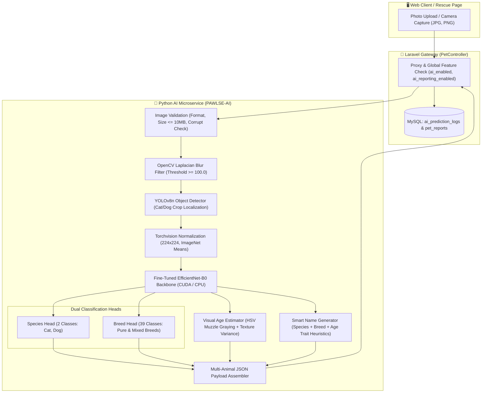
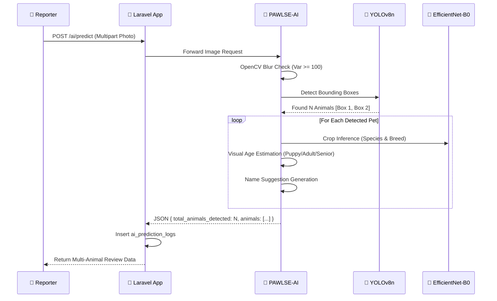

# 🧠 AI Architecture & Machine Learning Pipeline

PAWLSE features a dedicated **Deep Learning & Computer Vision Microservice** (`PAWLSE-AI`) integrated with the Laravel monolithic backend. It provides automated species localization, breed classification, age-group categorization, name suggestions, and safeguard filters for stray animal rescue.

---

## 📐 AI Pipeline Architecture

---

## 🔬 Core Components & Tech Stack

| Component | Technology | Purpose |
| :--- | :--- | :--- |
| **Model Serving Engine** | FastAPI `0.136.1` + Uvicorn `0.41.0` | Asynchronous REST microservice |
| **Object Localization** | Ultralytics YOLOv8n (`yolov8n.pt`) | Detects and extracts bounding boxes (`box.xyxy`) for all cats (class 15) and dogs (class 16) |
| **Classification Backbone** | PyTorch `2.11.0` / Torchvision `0.26.0` | Fine-tuned **EfficientNet-B0** dual-head convolutional network |
| **Image Preprocessing** | OpenCV `4.13.0` & Pillow `12.1.1` | Laplacian variance blur detection (`var >= 100.0`), tensor normalization |
| **Hardware Orchestration** | PyTorch CUDA / CPU Fallback | Dynamic GPU execution (`DEVICE = "cuda" if torch.cuda.is_available() else "cpu"`) |

---

## 🐾 Multi-Species Detection & Crop Pipeline

When a photo containing multiple animals is submitted:
1. **YOLOv8 Localization**: YOLOv8 scans the full image and detects all instances of cats and dogs.
2. **5% Margin Bounding Box Padding**: Each detected animal region is expanded with 5% margin padding to preserve ear tips and muzzle context.
3. **Isolated Per-Crop Inference**: Each crop is individually preprocessed to $(1, 3, 224, 224)$ and passed through EfficientNet-B0.
4. **Structured Multi-Animal Payload**: The response packages each animal into an `animals: [...]` array, retaining individual bounding boxes, confidence ratings, age groups, and name suggestions.

---

## 🎂 Visual Age Group Classification

The model stack includes an image-based visual age-group estimator (`estimate_age_group`) supporting **`Kitten/Puppy`**, **`Adult`**, and **`Senior`**:

1. **Muzzle / Snout Graying Index**:
   - Isolates the lower central region of the facial crop.
   - Evaluates the proportion of desaturated, high-value pixels in HSV color space ($\text{Saturation} \le 40$, $\text{Value} \ge 175$).
   - High graying index indicates mature/senior pet characteristics.
2. **Texture & Edge Density**:
   - Evaluates Laplacian gradient variance over coat texture.
   - Differentiates soft coat (kittens/puppies) from developed adult coat and textured senior fur.

---

## 🛡️ Model Safeguards & Quality Filters

1. **Blur Detection**:
   - Computes variance of the Laplacian filter:
     $$\sigma^2 = \text{Var}(\nabla^2 I)$$
   - If $\sigma^2 < 100.0$, the image is rejected with `accepted: false` and message `"The uploaded image is too blurry. Please provide a clearer photo."`
2. **Non-Pet Safeguard**:
   - If YOLO detects 0 cats and 0 dogs, the request is rejected with `"No cat or dog detected in the image."`
3. **Mixed-Breed Margin Detection**:
   - Computes entropy / top-2 probability gap.
   - If the margin between the top 2 predictions is narrow ($\le 0.15$), flags `is_mixed_breed: true` with a computed mixed score.

---

## 📊 Empirical Validation & Performance

Evaluated on the full 797-image validation dataset:
- **Breed Accuracy**: **89.21%**
- **Species Accuracy**: **99.37%**
- **Macro F1-Score**: **89.19%**
- **Inference Latency**: **51.1 ms / image** (CPU) / **<12 ms** (CUDA GPU)

---

## 🔗 Related Documentation
- [[System Architecture]]
- [[Backend Architecture]]
- [[Frontend Architecture]]
- [[AI Rescue & Multi-Species Identification]]
- [[AI Microservice & Model Pipeline]]
- [[Admin Features]]
- [[Super Admin Features]]
