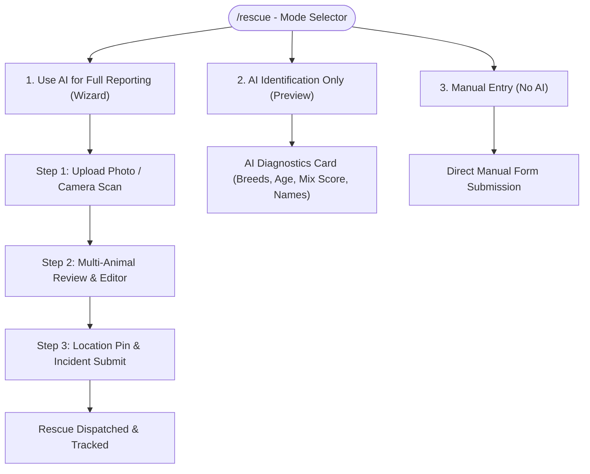
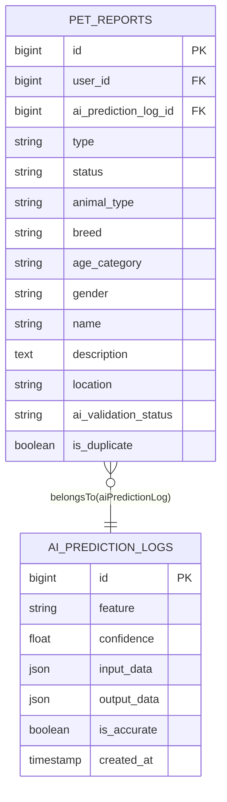

# 🐾 AI Rescue & Multi-Species Identification

The **AI-Assisted Rescue and Reporting System** allows community reporters, volunteers, and administrators to upload animal photos and receive real-time classification for species, breed, visual age category, and personalized pet names, supporting both single-pet and multi-pet rescue operations.

---

## 🚀 Reporting Modes Overview

Users visiting `/rescue` can select from three specialized flows:



---

## 📋 Multi-Step AI Wizard Flow

### Step 1: Image Upload & Real-Time Safeguards
- **Live Camera / File Picker**: Supports JPG, PNG, and video uploads (up to 10MB).
- **Automated Rejection Safeguards**:
  - **Blur Thresholding**: Rejects blurry captures ($\text{Var}(\text{Laplacian}) < 100.0$) with instant guidance to retake.
  - **Non-Pet Filtering**: Rejects images without cats or dogs.
  - **Corrupted File Catch**: Returns descriptive feedback if files cannot be decoded.

---

### Step 2: Multi-Species Review & Attribute Editor
- **Multi-Animal Detected Selector**:
  - When YOLOv8 localizes $\ge 2$ animals in a photo (e.g. 2 stray puppies or a cat & dog duo), interactive tabs display each pet:
    `🐾 #1: Dog (Golden Retriever)` vs `🐾 #2: Dog (French Bulldog)`
  - **Include/Exclude Toggle**: Allows the reporter to select which detected animals should be included in the official rescue report ticket.
  - **Active Attribute Editor**:
    - **Species**: `Dog` / `Cat` / `Other`
    - **Breed**: AI top prediction with editable input
    - **Age Category**: Mapped to standard shelter categories (`Puppy/Kitten`, `Junior`, `Prime/Adult`, `Senior`, `Geriatric`)
    - **Gender**: `Male`, `Female`, `Unknown`
    - **Suggested Name**: Auto-populated from curated pet name heuristics with inline editing.

---

### Step 3: Location Pinning, Guest/Verified Contact & Submit
- **Geocoding & Geolocation**: Instant browser location pin (`navigator.geolocation`) with reverse geocoding.
- **Incident Summary**: Displays a clean breakdown of all included pets:
  ```text
  🐾 Report Summary (2 Animals in Report):
  • #1: Dog · Golden Retriever (Puppy · Male · "Buddy")
  • #2: Dog · French Bulldog (Adult · Female · "Bella")
  ```
- **Backend Dispatch**: Posts primary pet parameters + JSON `animals` payload to `POST /pet-reports/rescue`.

---

## 🛡️ Administrative AI Validation & Governance

### 1. AI Validation Queue (`/account/admin/ai-validation`)
- Admins inspect all incoming reports with linked AI prediction logs (`ai_prediction_log_id`).
- **Multi-Species Analysis Switcher**: Displays each detected animal's confidence rating, bounding box, species, and breed side-by-side with user-submitted values.
- **Actions**:
  - **Approve**: Confirms AI findings as accurate and marks `ai_validation_status = 'approved'` (logging calibration telemetry).
  - **Flag & Correct**: Allows admins to override inaccurate predictions and correct breed/age/species records.

### 2. Super Admin AI Settings (`/account/super-admin/ai-configuration`)
- **Master AI Switch (`ai_enabled`)**: Instantly enables or suspends all AI inference system-wide.
- **Reporting Toggle (`ai_reporting_enabled`)**: Controls AI integration in rescue reporting.
- **Identification Toggle (`ai_identifying_enabled`)**: Controls standalone AI preview.
- **Confidence Threshold Slider (`ai_confidence_threshold`)**: Configurable threshold (default: `0.70`).

---

## 🗄️ Database Records & Relations



---

## 🔗 Related Documentation
- [[AI Architecture]]
- [[AI Microservice & Model Pipeline]]
- [[Admin Features]]
- [[Super Admin Features]]
- [[Controllers]]
- [[Schema]]
