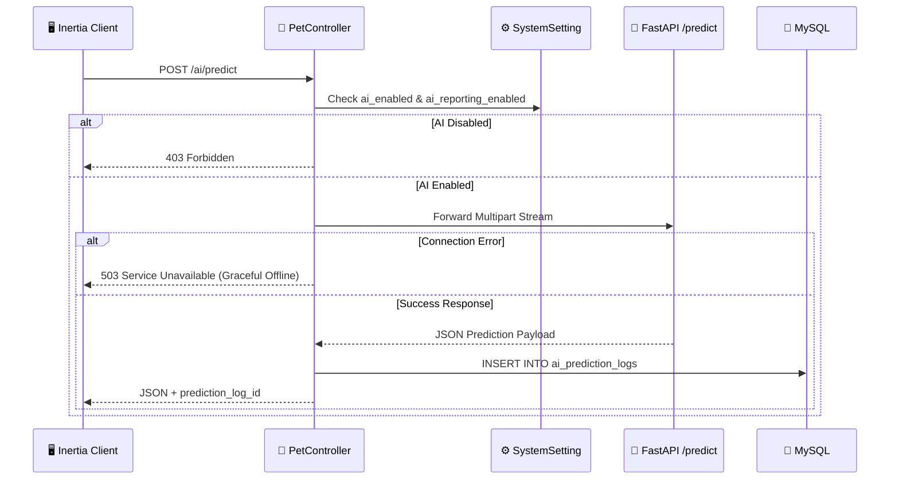

# 🔌 AI Microservice & Model Pipeline API

This document describes the API contract, request/response formats, error codes, and backend integration between the Laravel monolith and the **PAWLSE-AI** Python microservice.

---

## 📡 Service Configuration

- **Default Local Base URL**: `http://127.0.0.1:8000` (configurable via `AI_SERVICE_URL` in `.env` and `config/services.php`).
- **Inference Timeout**: 120 seconds (`Http::timeout(120)`).
- **GPU Acceleration**: NVIDIA CUDA tensor allocation with automatic CPU fallback.

---

## 🛰️ Microservice Endpoints

### 1. Health Check
`GET /health`

#### Response:
```json
{
  "status": "healthy",
  "device": "cuda",
  "classes_loaded": 39
}
```

---

### 2. Multi-Animal Inference
`POST /predict`

Accepts multipart image uploads (up to 10MB) in JPG, PNG, WEBP, or BMP format.

#### Request Headers & Body:
- `Content-Type: multipart/form-data`
- `image`: Binary file stream

#### Success Response (`200 OK`):
```json
{
  "accepted": true,
  "total_animals_detected": 2,
  "species": "dog",
  "species_confidence": 0.99,
  "breed": "Golden Retriever",
  "raw_breed": "dog_golden_retriever",
  "confidence": 0.94,
  "confidence_level": "High",
  "is_confident": true,
  "confidence_message": "The AI is confident in this result.",
  "is_mixed_breed": false,
  "mixed_confidence": 0.05,
  "age_group": "Puppy",
  "age_confidence": 0.88,
  "estimated_age_years": 0.5,
  "age_reason": "Soft coat edge variance and clean facial markings indicate puppy/young pet.",
  "suggested_names": ["Buddy", "Copper", "Milo"],
  "neutral_names": ["Buddy", "Copper", "Milo"],
  "breeds": [
    { "name": "Golden Retriever", "confidence": 0.94 },
    { "name": "Labrador Retriever", "confidence": 0.04 }
  ],
  "similar_breeds": [
    { "name": "Labrador Retriever", "confidence": 0.04 }
  ],
  "animals": [
    {
      "index": 1,
      "species": "dog",
      "species_confidence": 0.99,
      "breed": "Golden Retriever",
      "raw_breed": "dog_golden_retriever",
      "confidence": 0.94,
      "confidence_level": "High",
      "is_confident": true,
      "confidence_message": "The AI is confident in this result.",
      "is_mixed_breed": false,
      "mixed_confidence": 0.05,
      "age_group": "Puppy",
      "age_confidence": 0.88,
      "estimated_age_years": 0.5,
      "suggested_names": ["Buddy", "Copper", "Milo"],
      "neutral_names": ["Buddy", "Copper", "Milo"],
      "box": [120, 85, 430, 390],
      "detection_confidence": 0.91,
      "breeds": [
        { "name": "Golden Retriever", "confidence": 0.94 }
      ]
    },
    {
      "index": 2,
      "species": "dog",
      "species_confidence": 0.98,
      "breed": "French Bulldog",
      "raw_breed": "dog_french_bulldog",
      "confidence": 0.89,
      "confidence_level": "High",
      "is_confident": true,
      "is_mixed_breed": false,
      "age_group": "Adult",
      "age_confidence": 0.82,
      "estimated_age_years": 3.0,
      "suggested_names": ["Rocky", "Bruno", "Winston"],
      "neutral_names": ["Rocky", "Bruno", "Winston"],
      "box": [140, 420, 460, 710],
      "detection_confidence": 0.87,
      "breeds": [
        { "name": "French Bulldog", "confidence": 0.89 }
      ]
    }
  ]
}
```

#### Blur Rejection Response (`200 OK` with `accepted: false`):
```json
{
  "accepted": false,
  "message": "The uploaded image is too blurry. Please provide a clearer photo for accurate identification."
}
```

#### Non-Pet Rejection Response (`200 OK` with `accepted: false`):
```json
{
  "accepted": false,
  "message": "No cat or dog detected in the image. Please upload a clear photo of a dog or cat."
}
```

---

### 3. Name Generator Endpoint
`POST /generate-names`

#### Request Body (`application/json`):
```json
{
  "species": "dog",
  "breed": "Golden Retriever",
  "gender": "male",
  "age_group": "puppy"
}
```

#### Response:
```json
{
  "species": "dog",
  "breed": "Golden Retriever",
  "gender": "male",
  "age_group": "puppy",
  "names": ["Buddy", "Copper", "Milo", "Scout", "Sunny"]
}
```

---

## 🐘 Laravel Gateway (`PetController.php`)



---

## 🔗 Related Documentation
- [[AI Architecture]]
- [[AI Rescue & Multi-Species Identification]]
- [[External APIs]]
- [[API Overview]]
- [[Controllers]]
- [[Tables]]
